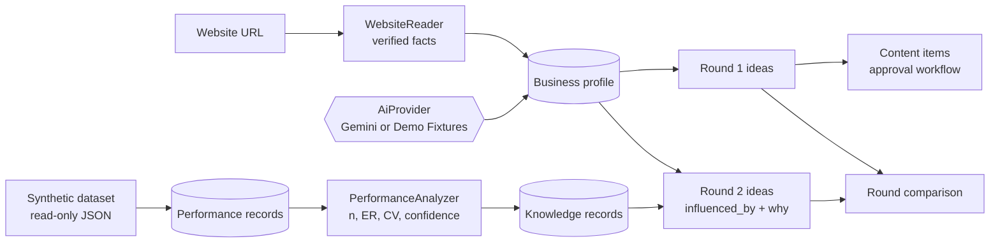

# GenAI Ratel CMS — Proof of Concept

A guided, five-step content workspace for the marketing manager of **Aquarium Park Dhaka**. It builds a business profile from the public website, plans and generates social media content, runs it through human approval and scheduling, analyses past post performance with explicit evidence rules, saves the qualifying insights as knowledge records, and generates a second round of ideas that shows exactly which evidence influenced each one.

Built for the Devpost **Build With AI: Basics** learning hackathon.

> **Important:** the performance data in this project is **synthetic demo data, not real Aquarium Park analytics**. No social media account is connected, and nothing is ever published to any platform. Every screen labels where its information came from.

---

## Contents

- [What it does](#what-it-does)
- [The five-step workflow](#the-five-step-workflow)
- [Features](#features)
- [How the evidence rules work](#how-the-evidence-rules-work)
- [What is real, simulated or synthetic](#what-is-real-simulated-or-synthetic)
- [Tech stack](#tech-stack)
- [Requirements](#requirements)
- [Installation](#installation)
- [Running the app](#running-the-app)
- [Configuration](#configuration)
- [AI modes: Demo Fixtures and Live AI](#ai-modes-demo-fixtures-and-live-ai)
- [Running the tests](#running-the-tests)
- [Project structure](#project-structure)
- [Data model](#data-model)
- [Security and safety measures](#security-and-safety-measures)
- [Known limitations](#known-limitations)
- [Troubleshooting](#troubleshooting)
- [Planning documents](#planning-documents)
- [Prior work and disclosure](#prior-work-and-disclosure)
- [License](#license)

---

## What it does

The proof of concept demonstrates one feedback loop:

1. **Profile** the business from its public website, separating verified facts from AI assumptions.
2. **Generate round-one content ideas** from the confirmed profile only.
3. **Generate, review, approve and schedule** content, with publishing deliberately disabled.
4. **Load and analyse performance data** (a labelled synthetic dataset) using fixed, testable evidence rules.
5. **Save qualifying insights as knowledge records** and **generate round two**, where every knowledge-driven idea names the records that shaped it, followed by a side-by-side comparison of round one and round two.

The loop works completely **without an API key** in Demo Fixtures mode, so anyone who clones the repository can run the full journey. Gemini (Live AI mode) is an optional upgrade.



---

## The five-step workflow

The **Dashboard** shows overall progress and one **Continue: [next step]** button. A five-step indicator appears on every step page; locked steps state what must be done first.

| Step | Screen | What happens |
|---|---|---|
| 1 — Business Profile | Business Profile | Enter the website URL (and optional social URLs). The app reads the site, extracts verified facts with source links, and adds AI-drafted assumptions. You edit and **Confirm** the profile. A manual entry form is available if the site can't be read. |
| 2 — Round-One Ideas | Content Workflow | Generate about six ideas across Facebook and Instagram in Text, Image, Carousel and Video (Reel) formats. Filter by platform, goal and format, then select the ideas to produce. |
| 3 — Generate, Review and Approve | Content Workflow → content | Each selected idea becomes a Draft content item. Submit, approve, request changes, reject, reopen, edit, regenerate and schedule. Every change is recorded in the item's status history. |
| 4 — Load and Analyse Performance | Performance & Insights | Load the 30-post synthetic dataset (read-only). See engagement comparisons by format, campaign goal and platform + format, each with sample size, variability and a confidence label. |
| 5 — Knowledge and Round Two | Knowledge Base, Content Workflow | Save qualifying insights as knowledge records, generate round two, and review the round-one vs round-two comparison. |

---

## Features

### Access
- Single administrator account, seeded from `.env`.
- Session login with rate limiting (5 attempts per minute per email and IP).
- Every page except the login page requires authentication.

### Step 1 — Website-grounded business profile
- Reads the homepage plus up to 8 same-domain pages (about, visit, contact and attraction pages first).
- **Verified facts** are extracted directly from the pages (business name, overview, attractions, contact email and phone, social profile links, headlines). Each keeps its source URL and retrieval time.
- **AI assumptions** (overview, audience, content opportunities, posting times, recommended platforms) are labelled as assumptions with the mode or model that produced them.
- Every field can be edited. Edited fields are labelled "Edited manually", and editing a confirmed profile returns it to Draft.
- A profile can't be confirmed without a business name.
- If the website can't be read, the error explains why and the manual entry form opens.

### Step 2 — Round-one ideas
- About six ideas per round, each with title, platform, format, campaign goal, audience, objective, hook, key message and call to action. Reel ideas include duration and aspect ratio.
- Round one uses the confirmed profile only. No performance knowledge is used.
- Filters by platform, campaign goal and format; ideas are grouped by platform.
- Round one is never replaced, so it remains available for comparison.

### Step 3 — Content generation and approval
- **Image and Carousel ideas:** caption, hashtags, CTA, alt text and an image. In Demo Fixtures mode the image is a bundled placeholder labelled "Demo fixture image — not generated in this session"; in Live AI mode it is generated by Gemini and labelled with the model name.
- **Video (Reel) ideas:** a production brief (script scenes, shot list, on-screen text, duration, aspect ratio, notes), clearly labelled **"Video Not Generated — Planning Preview Only"**. No video file is produced.
- **Text ideas:** caption, hashtags and CTA, no image.
- **Status workflow** with seven states: Draft, Pending Approval, Approved, Rejected, Scheduled, Published, Publishing Failed.
  - Draft → Pending Approval (submit)
  - Pending Approval → Approved, back to Draft (request changes, feedback required), or Rejected (reason required)
  - Rejected → Draft (reopen)
  - Approved → Scheduled; Scheduled → rescheduled or back to Approved (unschedule)
  - Scheduled → Published only through **Mark as Manually Published** (requires a confirmation tick) or **Simulate Publishing (demo)**
  - Editing an Approved or Scheduled item returns it to Draft for review again
  - Disallowed transitions are refused with a clear message
- **Status history** for every item: time (Asia/Dhaka), from-state, to-state, note and actor.
- Regeneration is allowed for drafts only.

### Scheduling with publishing disabled
- Schedule with date and time fields in **Asia/Dhaka** time; stored in UTC. Past and invalid times are refused.
- When the scheduled time passes, the item shows **"Ready to Publish — Manual Action Required"** and stays Scheduled: "Automatic publishing is disabled: no verified account connection."
- **Simulate Publishing** records a result labelled **"Simulated — not sent to any platform"**.
- **Mark as Manually Published** requires an explicit confirmation that the post really went out.
- The `content:check-due` command (scheduled every minute) adds one history note when a scheduled time is reached. It never publishes and is safe to run repeatedly.

### Step 4 — Performance analysis
- Loads the synthetic dataset read-only and validates every record before saving anything. Loading twice does not create duplicates.
- Every analytics screen shows the **"Synthetic Demo Data — Not Real Aquarium Park Analytics"** banner, and the top bar shows a Synthetic Demo Data indicator.
- Comparisons by **content format**, **campaign goal** and **platform + format**, with labelled CSS bar charts.
- Each group shows sample size (n), mean engagement rate, standard deviation, coefficient of variation (CV), mean click-through rate, the comparison with the other posts in the same dimension, and a confidence label.
- Groups with too few posts are shown as **Insufficient Evidence** and produce no recommendation.

### Step 5 — Knowledge records and round two
- Qualifying insights are saved as **knowledge records** with: key (for example `format:Reel`), observation, recommendation, supporting post IDs, sample size, excluded count, metrics, formula, CV, confidence, rationale, `evidence_type = synthetic`, source dataset and version. Rebuilding replaces records instead of duplicating them.
- The **Knowledge Base** lists records by category; each record page shows the exact supporting posts.
- **Round two** uses the confirmed profile *and* the knowledge records as explicit inputs:
  - Each knowledge-driven idea shows **"Why this was suggested"**, listing the records that influenced it with their numbers, confidence and supporting posts, labelled as a Simulated Insight from synthetic data.
  - Ideas not driven by knowledge (deliberate tests) are labelled **"Not knowledge-driven"**.
  - Removing a knowledge record changes the round-two selection (covered by an automated test).
- **Comparison panel:** round one vs round two by format, campaign goal and platform, plus calls to action and topics, with the disclaimer: *"This demonstrates the feedback loop working; it does not show that real engagement improved."*
- Round two can be regenerated, unless content has already been generated from it (to avoid deleting that content).

### Dashboard and guidance
- Current step, "x of 5 steps complete" progress bar, and a prominent **Continue** button.
- Cards for the business profile, round-one and approval status (counts per state, Ready-to-Publish count), performance data source, knowledge insights and round two.
- Empty states explain what each step does before it has data.

### Provenance labels
Every piece of information carries one of these labels: **Verified public**, **AI assumption**, **Manual entry**, **Edited manually**, **SYNTHETIC**, **AI insight / Simulated Insight**, **Demo fixture** and **Live AI · model name**.

---

## How the evidence rules work

The analysis is plain arithmetic, not AI, so it is reproducible and tested.

| Measure | Formula |
|---|---|
| Engagement rate (ER) per post | (likes + comments + shares) / reach × 100 |
| Click-through rate (CTR) per post | link_clicks / impressions × 100 |
| Variability | population standard deviation of ER; CV = SD / mean (undefined when the mean is 0) |
| Comparison | a group's mean ER minus the mean ER of all other valid posts in the same dimension, in percentage points (pp) |

**Confidence ladder:**

| Valid posts in the group | Label |
|---|---|
| fewer than 5 | Insufficient Evidence (no recommendation) |
| 5 to 9 | Low Confidence |
| 10 or more, and CV ≤ 0.5 | Medium Confidence |
| 10 or more, and CV > 0.5 or undefined | Low Confidence |

**High confidence is never assigned automatically.** Posts with reach ≤ 0 or missing metrics are excluded and counted. Labels look like `Medium Confidence · n=11 · CV=0.07`.

---

## What is real, simulated or synthetic

| Item | Status |
|---|---|
| Website facts in the business profile | Real, read from the public website, with source links |
| Profile assumptions, ideas, captions, briefs | AI output (Live AI) or pre-written demo fixtures, always labelled |
| Fixture images | Bundled placeholders, labelled as not generated in this session |
| Performance metrics | **Synthetic**: 30 fictional posts created for this demo |
| Knowledge records and round-two reasoning | Derived from synthetic data, labelled **Simulated Insight** |
| Publishing | **Disabled**. Only labelled simulations or user-confirmed manual publishing |
| Videos | **Not generated**. Production briefs only |

---

## Tech stack

| Piece | Choice |
|---|---|
| Framework | Laravel 12 (PHP ≥ 8.2) |
| Database | SQLite (`database/database.sqlite`) |
| Views | Blade templates with a small vanilla JavaScript file (no Node or build step) |
| Styling | Plain CSS (`public/css/app.css`) |
| HTTP | Laravel HTTP client (website reading, Gemini) |
| Scheduling | Laravel scheduler (`php artisan schedule:work` locally) |
| HTML parsing | PHP `DOMDocument` / `DOMXPath` |
| Tests | PHPUnit via `php artisan test` |
| Optional AI | Google Gemini API |

No extra Composer packages beyond the Laravel skeleton, no Node, no queues.

---

## Requirements

- **PHP 8.2 or newer** with the `pdo_sqlite`, `curl`, `openssl`, `mbstring` and `fileinfo` extensions.
- **Composer 2.**
- Internet access for `composer install`, for reading the business website in Step 1, and for Live AI mode. Demo Fixtures mode needs no API key.

Developed and tested on Windows with XAMPP (PHP 8.2.12) and Composer 2.2.25.

---

## Installation

PowerShell commands (Windows). On macOS or Linux use `cp` and `touch` instead of `Copy-Item` and `New-Item`.

```powershell
git clone <repository-url> genai-ratel-cms
cd genai-ratel-cms

composer install
Copy-Item .env.example .env
php artisan key:generate
New-Item database/database.sqlite -ItemType File
php artisan migrate --seed
```

Or use the bundled Composer script, which runs the same steps:

```powershell
composer run setup
```

Before running `migrate --seed`, you can change the demo login in `.env`:

```env
ADMIN_NAME="Demo Admin"
ADMIN_EMAIL=admin@example.com
ADMIN_PASSWORD=change-me-demo-only
```

> If you change `ADMIN_EMAIL` or `ADMIN_PASSWORD` **after** seeding, run `php artisan db:seed --class=AdminSeeder` to update the account.

---

## Running the app

```powershell
php artisan serve
```

Open http://127.0.0.1:8000 and log in with `ADMIN_EMAIL` / `ADMIN_PASSWORD` from `.env`.

If port 8000 is already in use, choose another port:

```powershell
php artisan serve --port=8010
```

Optional, in a second terminal, to record due-time events for scheduled content every minute:

```powershell
php artisan schedule:work
```

To run the due check once by hand:

```powershell
php artisan content:check-due
```

To start again from an empty workspace (this deletes this project's local data only):

```powershell
php artisan migrate:fresh --seed
```

### Suggested walkthrough

1. On the Dashboard, click **Continue: Step 1** and read `https://aquariumpark.com.bd/` (or use manual entry). Review and **Confirm** the profile.
2. Generate round-one ideas and select an Image idea and a Reel idea.
3. Generate content, submit it, request changes with feedback, submit again and approve. Schedule an item a couple of minutes ahead and watch it become **Ready to Publish** without turning Published. Try **Simulate Publishing**.
4. Load the synthetic dataset in **Performance & Insights** and review the evidence labels.
5. Save insights as knowledge records, generate round two, open "Why this was suggested", and review the comparison panel.

---

## Configuration

All settings live in `.env` (see `.env.example`; it contains placeholders only).

| Variable | Default | Purpose |
|---|---|---|
| `APP_DISPLAY_TZ` | `Asia/Dhaka` | Timezone for displaying and entering times (stored in UTC) |
| `ADMIN_NAME`, `ADMIN_EMAIL`, `ADMIN_PASSWORD` | demo values | The single administrator account created by the seeder |
| `AI_MODE` | `fixtures` | `fixtures` (no API calls) or `live` (Gemini) |
| `GEMINI_API_KEY` | empty | Required only for `AI_MODE=live` |
| `GEMINI_TEXT_MODEL` | `gemini-3.8-flash` | Text model for profiles, ideas and captions |
| `GEMINI_IMAGE_MODEL` | `gemini-2.5-flash-image` | Image model for Image and Carousel content |
| `SYNTHETIC_DATASET_PATH` | `aquariumpark_synthetic_demo/aquariumpark_synthetic_posts.json` | Read-only synthetic dataset |

---

## AI modes: Demo Fixtures and Live AI

The app talks to AI through one interface, `App\Services\Ai\AiProvider`, with two implementations. The active mode is shown as a badge in the top bar.

### Demo Fixtures (default)
- Pre-written, deterministic outputs from `resources/fixtures/`, labelled **Demo fixture**.
- Round two uses a transparent rule: a fixture idea is selected when one of its tags matches a knowledge record whose group performed above the comparison group. Ideas are ranked by the size of that difference.
- No network calls to any AI service; ideal for demos and for anyone cloning the repository.

### Live AI (Gemini)
Set in `.env`:

```env
AI_MODE=live
GEMINI_API_KEY=your-key-here
GEMINI_TEXT_MODEL=gemini-3.8-flash
GEMINI_IMAGE_MODEL=gemini-2.5-flash-image
```

- Uses Gemini `generateContent` with structured JSON output (response schemas). The key is sent in the `x-goog-api-key` header, never in the URL.
- Every response is validated against the expected shape. Invalid output, citations of knowledge records that don't exist, a missing image, rate limits (HTTP 429), timeouts, unknown models (HTTP 404) and rejected keys each produce a specific error. **Nothing is saved and nothing is replaced with fixture output silently.**
- Failures show a **Switch to Demo Fixtures** button. Switching lasts for the current login session; **Switch back to Live AI** is shown in the top bar.
- Round two sends the knowledge records (key, group, mean ER, difference, direction, confidence, sample size) in the prompt, marked as synthetic data. Gemini returns which records influenced each idea and why.
- Generated images are saved to `public/generated/`, which is git-ignored.
- Live output is labelled **Live AI · model name**; generated images are labelled with the image model and "review before use".

> Note: `gemini-2.5-flash` appears in the model list for new API keys but returns HTTP 404 ("no longer available to new users"). Use a current Flash model such as `gemini-3.8-flash`.

---

## Running the tests

```powershell
php artisan test
```

The suite (86 tests) covers authentication, dataset loading and validation, the evidence ladder and its boundaries, knowledge records, website reading (including private-address and redirect protection), round one and round two (including "removing a knowledge record changes round two"), the content workflow state machine, scheduling and time zones, the due-check command, dashboard progress, the Gemini provider with faked responses, and one end-to-end test of the whole journey from login to the round-two comparison.

Tests always run in Demo Fixtures mode (`phpunit.xml` sets `AI_MODE=fixtures`) and **block all real network requests**, so they never call Gemini or any website and never cost anything.

---

## Project structure

```
app/
├── Console/Commands/CheckDueContent.php     # content:check-due (never publishes)
├── Http/Controllers/
│   ├── Auth/LoginController.php
│   ├── DashboardController.php
│   ├── ProfileController.php                 # Step 1
│   ├── IdeasController.php                   # Steps 2 and 5 (rounds, selection)
│   ├── ContentItemController.php             # Step 3 (generation, review, scheduling)
│   ├── PerformanceController.php             # Step 4
│   ├── KnowledgeController.php               # Knowledge Base
│   └── AiModeController.php                  # Switch to Demo Fixtures / back to Live AI
├── Models/                                   # User, BusinessProfile, ContentRound, ContentIdea,
│                                             # ContentItem, StatusHistory, PerformanceDataset,
│                                             # PerformanceRecord, KnowledgeRecord
├── Services/
│   ├── Ai/AiProvider.php                     # interface
│   ├── Ai/FixtureProvider.php                # Demo Fixtures
│   ├── Ai/GeminiProvider.php                 # Live AI
│   ├── Ai/AiMode.php                         # active mode (env + session switch)
│   ├── WebsiteReader.php                     # safe website fetching and fact extraction
│   ├── ContentWorkflow.php                   # the only place content status changes
│   ├── WorkflowProgress.php                  # step states for Dashboard and indicator
│   ├── SyntheticDatasetLoader.php
│   ├── PerformanceAnalyzer.php               # evidence ladder
│   ├── KnowledgeBuilder.php
│   └── RoundComparison.php
└── Providers/AppServiceProvider.php          # binds AiProvider to the active mode
config/ai.php, config/performance.php
database/migrations/, database/seeders/AdminSeeder.php
resources/fixtures/                           # profile, round 1, round 2, content templates
resources/views/                              # layouts, components, pages per step
public/css/app.css, public/js/app.js
public/demo-fixtures/images/                  # labelled placeholder images
routes/web.php, routes/console.php
tests/Feature/, tests/Unit/
aquariumpark_synthetic_demo/                  # synthetic dataset (read-only)
devpost/                                      # scope, PRD, spec, build checklist
```

---

## Data model

All data is stored in `database/database.sqlite`. Timestamps are stored in UTC and displayed in Asia/Dhaka.

| Table | Holds |
|---|---|
| `users` | The single seeded administrator |
| `business_profiles` | Website URL, social URLs, fields with per-field provenance, sources, draft/confirmed status |
| `content_rounds` | Round number (1 or 2), AI mode, profile snapshot, knowledge record IDs used |
| `content_ideas` | Idea fields, selection, `influenced_by` record IDs, `knowledge_driven`, "why" text, provenance |
| `content_items` | Caption, hashtags, CTA, alt text, image and its provenance, video brief, status, schedule, publish method, feedback, rejection reason |
| `status_histories` | Append-only log of every status change and note |
| `performance_datasets` | Dataset key, version, synthetic flag, metadata, load time |
| `performance_records` | One row per synthetic post (unique per dataset and post ID) |
| `knowledge_records` | Saved insights with their full evidence |

---

## Security and safety measures

- **No secrets in the repository.** `.env` is git-ignored; `.env.example` contains placeholders only. Use environment variables for all credentials.
- **Website reading treats the internet as untrusted:**
  - only `http`/`https` URLs;
  - hosts are resolved and **private, loopback, link-local, reserved and carrier-grade NAT addresses are refused** (including IPv4-mapped IPv6);
  - redirects are followed manually (at most 3) and every hop is validated the same way;
  - the connection is pinned to the checked IP address;
  - 15-second timeout, at most 9 pages per analysis, identified user agent.
- **No real publishing.** Publishing to real accounts stays disabled until account access, authorization and permissions are verified.
- **No silent fallbacks.** If Live AI fails, the user sees why and chooses whether to switch modes.
- **Synthetic data is never presented as real** and is never mixed with real analytics.
- The synthetic dataset file is **read-only**; the app never writes to it.
- Login is rate-limited; CSRF protection is on for every form.

---

## Known limitations

- Single administrator and single business; no registration or roles.
- Runs locally; no deployment is provided.
- Performance data is synthetic. Real analytics or platform APIs are not connected.
- Publishing is disabled. "Publishing Failed" exists in the state model for a future integration but is not reachable.
- Videos are not generated; only production briefs.
- Live AI output can still contain inaccuracies (for example, naming an attraction the business doesn't have). Prompts restrict ideas to attractions listed in the profile, but every output should be reviewed; that is what the approval workflow is for.
- The "Switch to Demo Fixtures" choice lasts for the login session; the default mode comes from `AI_MODE`.
- Confidence never exceeds Medium, by design.

---

## Troubleshooting

| Problem | Fix |
|---|---|
| Can't log in after changing `ADMIN_EMAIL` / `ADMIN_PASSWORD` | Run `php artisan db:seed --class=AdminSeeder` |
| "Too many login attempts" | Wait one minute (5 attempts per minute) |
| Port 8000 already in use | `php artisan serve --port=8010` |
| Composer: `zip` extension missing (Windows/XAMPP) | Enable `extension=zip` in `php.ini`, or run `php -d extension=zip path\to\composer.phar install` |
| Composer 2.2 crashes in a fresh clone on Windows (`WindowsPipes` / `fclose(false)` during version guessing) | Set `$env:COMPOSER_ROOT_VERSION = "dev-main"` before `composer install`, or update Composer with `composer self-update` |
| Live AI: "Model … is not available to this API key (HTTP 404)" | Set `GEMINI_TEXT_MODEL=gemini-3.8-flash` (or another model your key can use) |
| Live AI: HTTP 429 | Rate limit or quota reached; wait, or switch to Demo Fixtures |
| Step 4 reports the dataset is missing | Check that `aquariumpark_synthetic_demo/aquariumpark_synthetic_posts.json` exists and `SYNTHETIC_DATASET_PATH` points to it |
| Styles look outdated after an update | Hard-refresh the browser (Ctrl+F5) |

---

## Planning documents

This project was planned before it was built. The documents in `devpost/` record the process:

- `devpost/scope.md` — the idea, the core loop and the proof-of-concept boundary
- `devpost/prd.md` — the product definition: journey, behaviours, states and acceptance criteria
- `devpost/spec.md` — the technical blueprint: stack, components, data model and failure modes
- `devpost/checklist.md` — the eight build slices, checkpoints and every revision made during the build

The build was done in eight slices, each implemented, tested and committed separately:

1. Laravel scaffold, login and synthetic dataset loading
2. Evidence-graded performance analysis and knowledge records
3. Website-grounded business profile with provenance
4. Round-one ideas, knowledge-driven round two and comparison
5. Content generation and approval workflow
6. Scheduling with manual and simulated publication
7. Dashboard and guided workflow progress
8. Optional Gemini Live AI provider

---

## Prior work and disclosure

- This application was **written from scratch during the hackathon** on a fresh Laravel 12 skeleton.
- The author's earlier Laravel project (*Ratel CMS AI v1*) was used **as a reference for the problem only**. No code from it was copied into this repository.
- The synthetic dataset in `aquariumpark_synthetic_demo/` was prepared for this hackathon as fictional demo data; its themes are based on the public Aquarium Park website. No private analytics or account access were used.
- The project was built with an AI coding assistant following the Build With AI: Basics plan-first workflow (scope → PRD → spec → sliced build).
- Aquarium Park Dhaka's name and public website are used to ground the demo. This project is not affiliated with or endorsed by Aquarium Park.

---

## License

Licensed under the [Apache License, Version 2.0](LICENSE). Copyright 2026 Abdullah Al Mamun.

The Laravel framework and other Composer dependencies are distributed under their own licenses (Laravel is MIT-licensed).
