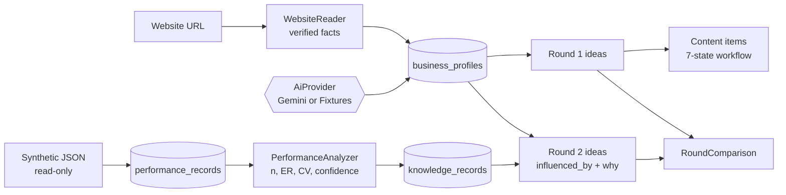

# GenAI Ratel CMS — Technical Spec

## How This Works, In Plain Language

GenAI Ratel CMS is one Laravel web app running on your machine, with one SQLite file as its database. There is nothing else to install or host.

- **The website reader** fetches Aquarium Park's public homepage and a few linked pages on the same site (about, attractions). It pulls out facts it can point to directly: the name, attractions, contact email and social links, each with its source URL and retrieval time. These are the **verified** facts.
- **The AI layer** has one interface with two interchangeable backends. **Live AI** calls Gemini. **Demo Fixtures** returns pre-written, labelled outputs from files in the repo, with no API call. The AI layer writes the *assumptions* (audience, opportunities, posting times), the content ideas, captions, images and video briefs. Everything it produces is tagged with the mode that produced it.
- **The workflow engine** moves each content item through seven states: Draft, Pending Approval, Approved, Rejected, Scheduled, Published and Publishing Failed. It refuses transitions that aren't allowed and writes every change to a history table. A scheduler command checks for overdue scheduled items every minute. It never publishes; it marks them **Ready to Publish — Manual Action Required**.
- **The performance analyser** reads the 30 synthetic posts, groups comparable posts (by format, campaign goal and platform+format), and calculates engagement rate and its consistency (CV). It then applies your evidence ladder: below 5 posts is Insufficient Evidence, 5–9 is Low, and 10 or more is Medium only if CV ≤ 0.5. This is plain arithmetic, not AI, so it's reproducible and testable.
- **Knowledge records** are the analyser's qualifying insights, saved with their evidence: post IDs, n, CV, formula, confidence, `evidence_type: synthetic`.
- **Round two** feeds the confirmed profile *and* the knowledge records into the AI layer. In Live AI mode they go into the Gemini prompt. In Demo Fixtures mode, a rule picks fixture ideas tagged to each knowledge record. Either way, each new idea stores which records influenced it, and the comparison panel diffs round one against round two.

Why this shape: the part that proves the idea is the evidence → knowledge → round-two chain. It works identically without any API key, so a judge who clones the repo sees the real loop. Live AI is an optional upgrade, not a dependency.

## The Core Journey Through the System
PRD ref: `prd.md > The Core Journey`.

1. **Log in.** The administrator, seeded from `.env`, signs in with a session. The Dashboard reads the progress of every step from the database and shows **Continue: [next step]**.
2. **Step 1.** The URL is submitted, and `WebsiteReader` validates it (http/https only, no private or internal hosts). It fetches the homepage plus up to 8 same-domain pages, strips them to text, and extracts verified facts. `AiProvider::profile()` (Gemini or fixture) returns assumption fields. Both are saved to `business_profiles` with per-field provenance. The user edits and confirms.
3. **Step 2.** `AiProvider::ideas(profile, knowledge: [])` returns about 6 ideas. They're saved as round 1 in `content_rounds` and `content_ideas`, and the user selects ideas.
4. **Step 3.** For each selected idea, `AiProvider::content(idea, profile)` returns a caption, hashtags, CTA and alt text, plus an image (image ideas) or a video brief (video ideas). These are saved to `content_items` as Draft. `ContentWorkflow` applies submit, approve, request changes, reject and schedule, and each change writes a row to `status_histories`. The `content:check-due` command (every minute) records "scheduled time reached" for overdue items.
5. **Step 4.** `SyntheticDatasetLoader` reads `aquariumpark_synthetic_demo/aquariumpark_synthetic_posts.json` read-only. It validates the data, then upserts it into `performance_records` by `post_id` (so loading twice doesn't duplicate). `PerformanceAnalyzer` builds the groups, metrics and confidence.
6. **Step 5.** `KnowledgeBuilder` saves qualifying insights (n ≥ 5) as `knowledge_records`. `AiProvider::ideas(profile, knowledge)` creates round 2, and each idea stores `influenced_by` (knowledge record IDs) and a "why" text. `RoundComparison` computes the differences shown in the comparison panel.



## Stack

| Piece | Choice | Why (learner-agreed) | Docs |
|---|---|---|---|
| Framework | Laravel 12 (PHP ≥ 8.2) | Learner's strongest framework; routing, validation, sessions, HTTP client, scheduler built in | https://laravel.com/docs/12.x |
| Database | SQLite (single file `database/database.sqlite`) | No server to install; reproducible | https://laravel.com/docs/12.x/database#sqlite-configuration |
| Views | Blade + small vanilla JS (no Node build) | Server-rendered, no build step | https://laravel.com/docs/12.x/blade |
| Styling | Plain CSS (`public/css/app.css`) | Full control of the agreed look; no tooling | — |
| HTTP | Laravel HTTP client | Website reading and Gemini calls; `Http::fake()` in tests | https://laravel.com/docs/12.x/http-client |
| Scheduler | Laravel scheduler, run locally with `php artisan schedule:work` | Server-side due checks without cron | https://laravel.com/docs/12.x/scheduling |
| HTML parsing | PHP `DOMDocument` / `DOMXPath` (built in) | No extra package | https://www.php.net/manual/en/class.domxpath.php |
| Tests | PHPUnit via `php artisan test` | Ships with Laravel | https://laravel.com/docs/12.x/testing |
| Live AI (optional) | Gemini API | Learner's preferred provider; provider-independent interface | https://ai.google.dev/gemini-api/docs |

No other Composer packages, no Node, no queues.

**Environment verified (2026-10-13):** PHP 8.2.12 (Laravel 12 requires ≥ 8.2 ✔), extensions `pdo_sqlite`, `curl`, `openssl`, `mbstring`, `gd` present ✔. Composer **2.2.25** is old. Verify early that `composer create-project laravel/laravel:^12.0` succeeds; if it doesn't, run `composer self-update`.

## Where It Runs and How Someone Tries It

- **Runtime:** local only. PHP ≥ 8.2 with `pdo_sqlite`, Composer 2. No API key is needed by default.
- **Setup (README will match this exactly):**
  ```
  composer install
  copy .env.example .env
  php artisan key:generate
  type nul > database\database.sqlite      (or: New-Item database/database.sqlite)
  php artisan migrate --seed
  php artisan serve                         → open http://127.0.0.1:8000
  php artisan schedule:work                 (second terminal; optional, records due-time events)
  ```
- **Login:** `ADMIN_EMAIL` / `ADMIN_PASSWORD` from `.env` (defaults documented in `.env.example` and the README; demo-only credentials).
- **Mode:** `AI_MODE=fixtures` (default) or `AI_MODE=live` with `GEMINI_API_KEY`. The active mode shows as a badge in the top bar.
- **Demo recording:** run through Steps 1–5 in fixtures mode, which is fully deterministic. Optionally show one live generation.
- **Deployment:** none planned. The submission is the public repo plus a demo video under 3 minutes.

## Look and Feel
Implements `prd.md > Look and Feel`.

- **CSS variables** in `app.css`:
  - `--navy #0B2540` (sidebar, headings)
  - `--teal #0E7C86` (primary actions, active step)
  - `--teal-dark #0A5F67`
  - `--aqua #D7F1F2` (soft highlights)
  - `--bg #F5F8FA`
  - `--card #FFFFFF`
  - `--text #1B2733`
  - `--muted #5B6B7A`
  - `--border #DDE5EB`
  - status: `--ok #1E8E5A`, `--warn #B7791F`, `--bad #C0392B`
- Check contrast for text on navy and teal (≥ 4.5:1).
- **Type:** system UI sans-serif stack (`"Segoe UI", Roboto, "Helvetica Neue", Arial, sans-serif`); scale 13/14/16/20/24/30; tabular numbers for metrics.
- **Layout:** fixed left sidebar (240px, navy) with five items; top bar with the mode badge, a **Synthetic Demo Data** indicator once data is loaded, and logout. The content area has a max width of about 1200px with cards (8px radius, 1px border, very soft shadow).
- **Provenance badges:** one reusable Blade component, `<x-provenance type="...">`, with five distinct styles:
  - verified public: outlined teal + link icon
  - AI assumption: dashed grey
  - synthetic metric: amber-outlined "SYNTHETIC"
  - real metric: solid green (future)
  - AI insight: aqua, with its source suffix

  Plus mode badges for fixture or live output.
- **Confidence chip:** `Low Confidence · n=7 · CV=0.61`; Insufficient shown in grey.
- **Charts:** simple CSS horizontal bars with labels, n and source caption (no chart library).
- **Interface copy:** plain, precise, non-hyped. No purple, no gradients, no glow, no decorative aquarium illustrations.

## Components

### Authentication
A hand-rolled session login (`LoginController`) and an `auth` middleware on every app route. One user, seeded by `AdminSeeder` from `.env`. No registration, no roles.
PRD ref: `prd.md > Access`.

### Dashboard and Workflow Progress
`WorkflowProgress` service computes each step's state from the database:
- Step 1: profile confirmed
- Step 2: round 1 exists and has a selection
- Step 3: at least one item Approved or Scheduled
- Step 4: dataset loaded
- Step 5: round 2 exists

Locked steps show their reason. The Dashboard and the step indicator both use it.
PRD ref: `prd.md > Screens and Layout`, `prd.md > States and Boundaries`.

### WebsiteReader
- Validates the URL: http/https only. It resolves the host and rejects private, loopback and link-local addresses.
- Follows redirects manually (at most 3), applying the same validation to every hop before requesting it.
- Fetches with a 15s timeout and the user-agent `GenAIRatelCMS/0.1 (+demo)`.
- Collects up to 8 same-domain links, prioritising `/about` and `/attractions/*`.
- Extracts verified facts: site name (`og:site_name` or `<title>`), contact emails (`mailto:`), social profile links (facebook, instagram, x/twitter, youtube, tiktok, linkedin), attraction names (link text under `/attractions/`), and headings, each with `source_url` and `retrieved_at`.
- Returns cleaned page text (capped at about 12k chars) for the AI layer.
- On failure, it returns an error the UI shows next to the manual-entry form.

PRD ref: `prd.md > Step 1 — Business Profile`.

### AI Provider Layer
- An `AiProvider` interface with:
  - `profile(array $facts, string $text): ProfileDraft`
  - `ideas(BusinessProfile $p, Collection $knowledge, int $round): array`
  - `content(ContentIdea $idea, BusinessProfile $p): ContentDraft`
- Bound in `AppServiceProvider` according to `config('ai.mode')`.
- **`FixtureProvider`** reads JSON files in `resources/fixtures/`.
  - For round 2, it selects fixture ideas whose `insight_keys` match existing knowledge record keys (e.g., `format:Reel`). Each idea gets `influenced_by` and a "why" built from the record's actual numbers.
  - If no knowledge matches, it includes its `untagged` exploratory ideas, labelled "not knowledge-driven".
  - Output is tagged `provenance = demo_fixture`.
- **`GeminiProvider`**:
  - Text through `generateContent` with `responseMimeType: application/json` and a `responseSchema`.
  - Images through an image-capable Gemini model.
  - Output is validated against the same shape as the fixtures before saving.
  - Errors are mapped to safe messages (missing key, 429 quota, timeout, invalid JSON). The UI offers **Switch to Demo Fixtures**; it never substitutes fixture output silently.
  - Output is tagged `provenance = live_ai` with the model name.

PRD ref: `prd.md > Step 2 — Round-One Content Ideas`, `prd.md > Step 3 — Generate, Review and Approve`, `prd.md > Step 5 — Knowledge Feedback and Round Two`.

### Content Workflow (state machine)
`ContentWorkflow` holds the allowed-transition table from `prd.md > Step 3` and exposes methods:
- `submit`
- `approve`
- `requestChanges(feedback)` (required)
- `reject(reason)` (required)
- `reopen`
- `schedule(datetime)` (must be in the future, Asia/Dhaka input, stored as UTC)
- `unschedule`
- `simulatePublish`
- `markManuallyPublished(confirm)`
- `edit` (Approved or Scheduled → Draft)

Each method runs in a DB transaction, rejects invalid transitions with a domain exception that's shown as a flash message, and writes a `status_histories` row.

"Ready to Publish — Manual Action Required" is computed as `status = scheduled AND scheduled_at <= now()`.

PRD ref: `prd.md > Step 3 — Generate, Review and Approve`.

### Due Check (scheduler)
The `content:check-due` Artisan command runs every minute (`routes/console.php`). It finds overdue scheduled items without a `due_recorded_at`, then sets `due_recorded_at` and writes a history note: "Scheduled time reached. Automatic publishing is disabled (no verified account)." It never changes the status to Published. It's idempotent.
PRD ref: `prd.md > Step 3 — Generate, Review and Approve` (scheduling with publishing disabled).

### SyntheticDatasetLoader
- Reads the canonical JSON (path from `config('performance.synthetic_path')`) and never writes to it.
- Validates: `synthetic === true`; 30 posts; required fields; numeric non-negative metrics; `data_source = SYNTHETIC_DEMO`; `is_real_performance_data = false`.
- Upserts the dataset row and `performance_records` (unique `dataset_id + post_id`).
- Reports what failed if the file is missing or invalid.

PRD ref: `prd.md > Step 4 — Load and Analyse Performance`.

### PerformanceAnalyzer
- For each dimension (`content_format`, `campaign_goal`, `platform+content_format`), groups the records and computes, per group:
  - n_valid and n_excluded (excluded if reach ≤ 0 or a required metric is missing)
  - mean ER where ERᵢ = (likes + comments + shares) / reach × 100
  - population std dev
  - CV = sd / mean (undefined if mean = 0)
  - mean CTR = link_clicks / impressions × 100
- **Confidence rule:**
  - n < 5 → Insufficient
  - 5–9 → Low
  - n ≥ 10 and CV defined and ≤ 0.5 → Medium
  - n ≥ 10 and CV > 0.5 or undefined → Low
  - High is never assigned
- **Comparison:** each eligible group's mean ER is compared with the mean ER of all other valid records in the same dimension. An observation is produced only when the group is at least Low confidence. The formula and denominator are shown with every figure. Missing values display "N/A".

PRD ref: `prd.md > Step 4 — Load and Analyse Performance`.

### KnowledgeBuilder
- Turns each non-Insufficient group finding into a `knowledge_records` row: a stable `key` (e.g., `format:Reel`), category, templated observation and recommendation text, supporting post IDs, n, excluded count, metrics JSON, formula, CV, confidence and rationale, `evidence_type = synthetic`, `source_dataset = aquariumpark_synthetic_demo`, and `analysed_at`.
- Re-running replaces records with the same key and dataset version; it never duplicates them.

PRD ref: `prd.md > Step 5 — Knowledge Feedback and Round Two`.

### RoundComparison
Computes the round 1 vs round 2 distributions of format, campaign goal and platform, the CTA list, and a topic list. It shows the deltas plus the fixed disclaimer text.
PRD ref: `prd.md > Step 5 — Knowledge Feedback and Round Two`.

## Data Model

All tables are in `database/database.sqlite`. Timestamps are stored in UTC and displayed in `Asia/Dhaka` (`APP_DISPLAY_TZ`). Everything persists across restarts. There's one business, and every row belongs to the single admin.

| Table | Key columns | Notes |
|---|---|---|
| `users` | id, name, email, password | One seeded admin |
| `business_profiles` | id, website_url, social_urls (json), fields (json: `{key: {value, provenance, source_url?, retrieved_at?}}`), sources (json), status (`draft`/`confirmed`), confirmed_at, ai_provenance | One row; editing a confirmed profile sets it back to draft |
| `content_rounds` | id, number (1/2), mode, profile_snapshot (json), knowledge_record_ids (json), created_at | Round 1 is kept so the comparison works |
| `content_ideas` | id, round_id, title, platform, format, campaign_goal, audience, objective, cta, hook, key_message, duration_s, aspect_ratio, why, influenced_by (json ids), knowledge_driven (bool), selected (bool), provenance | |
| `content_items` | id, idea_id, caption, hashtags, alt_text, image_path, image_provenance, video_brief (json), status, scheduled_at, due_recorded_at, published_at, publish_method (`simulated`/`manual`), feedback, rejection_reason, provenance | `status` is limited to the 7 PRD states |
| `status_histories` | id, content_item_id, from_status, to_status, note, actor, created_at | Append-only |
| `performance_datasets` | id, key, name, version, is_synthetic, metadata (json), source_path, loaded_at | Synthetic and real data are always separate datasets |
| `performance_records` | id, dataset_id, post_id, published_date, platform, content_format, post_theme, caption_excerpt, campaign_goal, impressions, reach, likes, comments, shares, link_clicks, saves, data_source, is_real_performance_data | Unique (dataset_id, post_id); nullable metrics mean N/A |
| `knowledge_records` | id, key, category, observation, recommendation, dimension, group_value, supporting_post_ids (json), sample_size, excluded_count, metrics (json), formula, cv, confidence, rationale, evidence_type, source_dataset, dataset_version, analysed_at | Unique (key, source_dataset, dataset_version) |

Generated images are stored in `storage/app/public/generated/` (served through `php artisan storage:link`). Fixture images are bundled in `public/demo-fixtures/images/`.

## File Structure

```
build-with-ai-basics/
├── app/
│   ├── Console/Commands/CheckDueContent.php     # content:check-due
│   ├── Http/Controllers/
│   │   ├── Auth/LoginController.php
│   │   ├── DashboardController.php
│   │   ├── ProfileController.php                 # Step 1
│   │   ├── IdeasController.php                   # Steps 2 & round 2
│   │   ├── ContentItemController.php             # Step 3 actions
│   │   ├── PerformanceController.php             # Step 4
│   │   └── KnowledgeController.php               # Step 5 + Knowledge Base
│   ├── Models/  (User, BusinessProfile, ContentRound, ContentIdea, ContentItem,
│   │            StatusHistory, PerformanceDataset, PerformanceRecord, KnowledgeRecord)
│   ├── Services/
│   │   ├── Ai/AiProvider.php                     # interface
│   │   ├── Ai/FixtureProvider.php
│   │   ├── Ai/GeminiProvider.php
│   │   ├── Ai/AiException.php
│   │   ├── WebsiteReader.php
│   │   ├── ContentWorkflow.php
│   │   ├── WorkflowProgress.php
│   │   ├── SyntheticDatasetLoader.php
│   │   ├── PerformanceAnalyzer.php
│   │   ├── KnowledgeBuilder.php
│   │   └── RoundComparison.php
│   └── Providers/AppServiceProvider.php          # binds AiProvider by AI_MODE
├── config/ai.php, config/performance.php
├── database/migrations/ … , database/seeders/AdminSeeder.php
├── resources/
│   ├── fixtures/  profile.json, ideas_round1.json, ideas_round2.json, content.json
│   └── views/
│       ├── layouts/app.blade.php                 # sidebar, top bar, badges
│       ├── components/ provenance, confidence, step-indicator, status-pill
│       ├── auth/login.blade.php, dashboard.blade.php
│       ├── profile/, ideas/, content/, performance/, knowledge/
├── public/css/app.css, public/js/app.js (tiny: confirm dialogs, toggles)
├── public/demo-fixtures/images/                  # bundled, labelled example images
├── routes/web.php, routes/console.php
├── tests/Feature/ … , tests/Unit/PerformanceAnalyzerTest.php
├── aquariumpark_synthetic_demo/                  # canonical JSON, read-only
├── devpost/                                      # planning docs
├── .env.example, README.md, LICENSE
```

The Laravel skeleton is created in a temporary folder and moved in, because the workspace already holds Skill Pack and `devpost/` files. Existing files are preserved.

## External Services and Dependencies

### Website (Aquarium Park, public)
`GET https://aquariumpark.com.bd/` and linked same-domain pages. Checked on 2026-10-13: 200 OK, server-rendered, about 4.5k characters of text, links to `/about`, `/attractions/*` and its Facebook, YouTube, X and TikTok profiles. No key needed. Be polite: at most 9 requests per analysis, 15s timeout.

### Gemini API (optional, Live AI mode only)
- Base `https://generativelanguage.googleapis.com/v1beta/models/{model}:generateContent`, header `x-goog-api-key: $GEMINI_API_KEY`. Docs: https://ai.google.dev/api/generate-content
- Text: `GEMINI_TEXT_MODEL` (default `gemini-2.5-flash`), with `generationConfig.responseMimeType = "application/json"` and `responseSchema`. Docs: https://ai.google.dev/gemini-api/docs/structured-output
- Image: `GEMINI_IMAGE_MODEL` (default `gemini-2.5-flash-image`). The response contains `inlineData` (base64 PNG), which is saved to storage. Docs: https://ai.google.dev/gemini-api/docs/image-generation
- **Unverified, so check early:** current model names, whether the learner's key has image-model access, and free-tier rate limits and pricing (https://ai.google.dev/gemini-api/docs/pricing). No live lookup was done while writing this spec.

## Important Failure Modes
- **Website unreachable or blocked** → an error with the reason, and the manual profile form opens with all fields marked as manual entries.
- **Live AI fails (no key, 429, timeout, bad JSON)** → a flash error naming the cause, plus a **Switch to Demo Fixtures** button. Existing work is untouched and no fixture is substituted silently.
- **Dataset missing or invalid** → Step 4 shows what failed (path or field) and nothing is loaded partially, because loading runs in a transaction.
- **Scheduler not running** → overdue items still display "Ready to Publish" because it's computed at render time. Only the history note waits for the scheduler.

## What Was Simplified and Why
- **A deterministic website extractor plus an AI summary** instead of a search or crawling service: the site is server-rendered, which removes one external service. The fuller version would add Tavily-style discovery and social-profile analysis.
- **Fixture-based round two using rule-based selection** instead of requiring an LLM: judges can run the real loop without a key. Live mode uses Gemini with the knowledge records in the prompt.
- **A single admin seeded from `.env`** instead of registration and roles: the PRD needs one administrator.
- **CSS bar charts** instead of a chart library: no build step.
- **"Ready to Publish" computed at render** plus a lightweight scheduler command, instead of queue workers: publishing is disabled, so there's nothing to dispatch.
- **No real publishing or analytics integration**: no verified account access (`scope.md > Explicitly Cut`).

## Decisions and Open Issues

**Learner decisions:** Laravel 12 + SQLite + Blade + plain CSS, no Node build; Gemini as the preferred live provider behind a provider-independent interface; Demo Fixtures as the default mode so no key is needed; the CV rule (Medium needs n ≥ 10 and CV ≤ 0.5; High is never assigned automatically); the ER formula; excluded records reported; all synthetic-derived insights labelled Simulated Insight.

**Implementation details derived from those decisions (agent):** AI is kept off the evidence path; "verified" means extracted directly from a fetched page; the admin is seeded from `.env`; demo images are bundled and labelled; each group is compared against the mean of the other groups in its dimension; population standard deviation is used; the 3 analysis dimensions; about 6 ideas per round.

**Learner uncertainty discussed:** "Do not assume the proposed PHP version is sufficient without checking Laravel 12's requirements." Clarified by checking: Laravel 12 needs PHP ≥ 8.2 and the machine has 8.2.12 with `pdo_sqlite`. Remaining check for the first build step: Composer 2.2.25 creating a Laravel 12 project; run `composer self-update` if it fails.

**Self-review note:** `Publishing Failed` is in the state list, but no proof-of-concept path reaches it because real publishing is disabled. It stays in the model for a future integration and is not shown as an action.

**Open (resolve during build):**
- Gemini model names and image access for the learner's key. Verify with one test call before building `GeminiProvider`.
- Fixture images: source or create a few legally usable example images (or labelled SVG placeholders) before Step 3.
- The CSV copy in `aquariumpark_synthetic_demo/` still differs from the JSON (dates). Re-export or delete it before shipping (`scope.md > Open Questions`).
